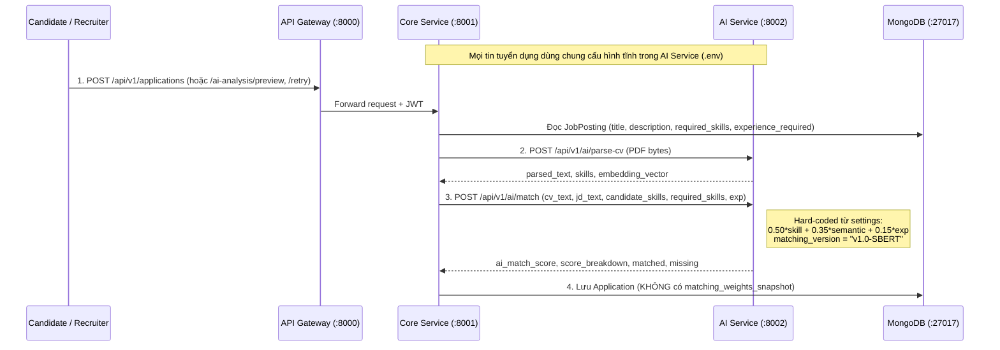

# BÁO CÁO AUDIT KIẾN TRÚC & KẾ HOẠCH NÂNG CẤP TRỌNG SỐ AI MATCHING (PHASE 0)
## Tính năng: Cấu hình Trọng số Đánh giá CV–JD theo từng Tin tuyển dụng (`Configurable Matching Weights`)

- **Ngày thực hiện:** 27/11/2026
- **Repository:** `Recruitment_Project` (`f:/MonHoc/Do_an_chuyen_nganh/Recruitment_project - Copy`)
- **Nhánh Git hiện tại:** `main` (`HEAD = 559ae04`, đồng bộ `origin/main`)
- **Trạng thái can thiệp mã nguồn & dữ liệu:** **Chưa chỉnh sửa bất kỳ file code hay dữ liệu MongoDB nào** (tuân thủ nguyên tắc dừng sau Phase 0 chờ phê duyệt).

---

## 1. Kiến Trúc Hiện Tại (Backend, AI Service, Frontend & Database)

### 1.1. Backend — Core Service (`Port 8001`)
1. **Model & Schema `job_postings`:**
   - Model `JobPosting` tại [job.py](file:///f:/MonHoc/Do_an_chuyen_nganh/Recruitment_project%20-%20Copy/services/core-service/app/models/job.py#L7-L32) hiện lưu: `company_id`, `recruiter_id`, `title`, `description`, `required_skills`, `level`, `experience_required`, `salary`, `location`, `job_embedding_vector`, `embedding_model`, `views_count`, `applications_count`, `status`, `created_at`, `updated_at`, `deleted_at`. **Chưa có trường `matching_weights`.**
   - Schema `JobCreateSchema` và `JobUpdateSchema` tại [schemas/job.py](file:///f:/MonHoc/Do_an_chuyen_nganh/Recruitment_project%20-%20Copy/services/core-service/app/schemas/job.py#L5-L22) **chưa nhận `matching_weights`**.
2. **Các API quản lý & truy xuất `job_postings` tại [routers/jobs.py](file:///f:/MonHoc/Do_an_chuyen_nganh/Recruitment_project%20-%20Copy/services/core-service/app/routers/jobs.py) & [job_service.py](file:///f:/MonHoc/Do_an_chuyen_nganh/Recruitment_project%20-%20Copy/services/core-service/app/services/job_service.py):**
   - Tạo tin (Recruiter): `POST /api/v1/jobs` (`create_job` — trả `{"message", "data": JobPosting}`) và `POST /api/v1/jobs/managed` (`create_managed_job` — trả `{"message", "data": serialize_job(job)}`). Cả hai đều kiểm tra `current_user.user_type == "RECRUITER"` và `current_user.company_id != None`.
   - Sửa tin (Recruiter): `PUT /api/v1/jobs/{job_id}`, `PATCH /api/v1/jobs/{job_id}` và `PUT /api/v1/jobs/managed/{job_id}`. Kiểm tra quyền sở hữu chặt chẽ `job.recruiter_id == current_user.id` (sai trả `403`).
   - Danh sách tin của HR: `GET /api/v1/jobs/my-jobs` (và `/mine`) — gọi hàm thủ công `serialize_job(job)` ([routers/jobs.py](file:///f:/MonHoc/Do_an_chuyen_nganh/Recruitment_project%20-%20Copy/services/core-service/app/routers/jobs.py#L69-L106)). *Lưu ý quan trọng: Hàm `serialize_job` dựng dict tường minh từng trường nên nếu không bổ sung `matching_weights` vào đây, Frontend `ManageJobs.jsx` sẽ không nhận được trọng số khi mở form chỉnh sửa.*
   - Chi tiết & tìm kiếm tin phía Candidate: `GET /api/v1/jobs/{job_id}` và `GET /api/v1/jobs` — dùng MongoDB Aggregation + `_serialize_candidate_job(doc)` ([routers/jobs.py](file:///f:/MonHoc/Do_an_chuyen_nganh/Recruitment_project%20-%20Copy/services/core-service/app/routers/jobs.py#L29-L66)), chỉ ẩn `job_embedding_vector` và `embedding_model`.
   - Lưu ý: Backend hiện chưa có endpoint riêng cho HR lấy chi tiết 1 tin theo ID (ví dụ `GET /api/v1/jobs/managed/{job_id}` cho cả tin `CLOSED`/`HIDDEN` hoặc công ty `PENDING`); `CandidateRanking.jsx` hiện gọi `GET /api/v1/jobs/my-jobs` rồi lọc theo `jobId`.
3. **Model, Schema & Lưu trữ `applications`:**
   - Model `Application` tại [models/application.py](file:///f:/MonHoc/Do_an_chuyen_nganh/Recruitment_project%20-%20Copy/services/core-service/app/models/application.py#L13-L48) lưu:
     - `ai_match_score: Optional[float] = None` (điểm tổng thang `0–100`, chặn biên qua `_clamp_score`).
     - `matching_version: Optional[str] = "v1.0"` (ghi đè từ response AI Service, thực tế đang lưu `"v1.0-SBERT"`).
     - `ai_analysis: Optional[AIAnalysis] = None` gồm `matched: List[ObjectId]`, `missing: List[ObjectId]`, `score_breakdown: Optional[Dict[str, float]]`, `recommendation: Optional[str]`.
     - **Chưa có trường `matching_weights_snapshot`.**
   - Các API trả kết quả ứng tuyển & xếp hạng:
     - `GET /api/v1/jobs/{job_id}/applications` ([application_service.py](file:///f:/MonHoc/Do_an_chuyen_nganh/Recruitment_project%20-%20Copy/services/core-service/app/services/application_service.py#L504-L621)): Xếp hạng ứng viên cho HR theo `{"ai_match_score": -1, "applied_at": -1}`, trả `List[RankedApplicationItem]`.
     - `GET /api/v1/applications/{id}` ([applications.py](file:///f:/MonHoc/Do_an_chuyen_nganh/Recruitment_project%20-%20Copy/services/core-service/app/routers/applications.py#L63-L76)): Trả `ApplicationDetailResponse` cho Candidate chủ đơn hoặc HR chủ tin.
     - `GET /api/v1/applications/{id}/ai-analysis` & `GET /api/v1/ai-analysis/applications/{id}`: Trả `ApplicationResponse` (cho phép Candidate chủ đơn, HR chủ tin và Admin).
     - `GET /api/v1/applications/me`: Danh sách đơn của Candidate.
   - Thống kê Admin (`GET /api/v1/admin/statistics` — [admin_service.py](file:///f:/MonHoc/Do_an_chuyen_nganh/Recruitment_project%20-%20Copy/services/core-service/app/services/admin_service.py#L147-L150)): Gom nhóm động `by_matching_version` theo giá trị chuỗi lưu trong DB, tương thích tự nhiên khi xuất hiện `"v2.0-configurable"`.

### 1.2. AI Service (`Port 8002`) — Xác Minh Công Thức Thực Tế
Kiểm tra trực tiếp tại [config.py](file:///f:/MonHoc/Do_an_chuyen_nganh/Recruitment_project%20-%20Copy/services/ai-service/app/core/config.py), [matching.py](file:///f:/MonHoc/Do_an_chuyen_nganh/Recruitment_project%20-%20Copy/services/ai-service/app/schemas/matching.py), [ai_matching.py](file:///f:/MonHoc/Do_an_chuyen_nganh/Recruitment_project%20-%20Copy/services/ai-service/app/routers/ai_matching.py) và [similarity.py](file:///f:/MonHoc/Do_an_chuyen_nganh/Recruitment_project%20-%20Copy/services/ai-service/app/services/similarity.py):

1. **Xác minh công thức tổng hợp hiện tại (`similarity.py` dòng 112–117):**
   ```python
   final_score = round(
       settings.SKILL_WEIGHT * skill_score
       + settings.SEMANTIC_WEIGHT * semantic_score
       + settings.EXPERIENCE_WEIGHT * experience_score,
       1,
   )
   ```
   Trong `config.py` (dòng 16, 23–25) và `services/ai-service/.env`:
   - `SKILL_WEIGHT = 0.50`
   - `SEMANTIC_WEIGHT = 0.35`
   - `EXPERIENCE_WEIGHT = 0.15`
   - `MATCHING_VERSION = "v1.0-SBERT"`
   → **Xác nhận 100%:** Mã nguồn hiện tại đang tính cố định `round(0.50 * skill_score + 0.35 * semantic_score + 0.15 * experience_score, 1)` theo biến môi trường toàn cục của AI Service, chưa nhận trọng số theo từng request.

2. **Xác minh chính xác 3 công thức điểm thành phần hiện tại:**
   - **`semantic_score` (`similarity.py` dòng 53–62):**
     - Mã hóa `[clean_text(cv_text), clean_text(jd_text)]` bằng Sentence-BERT `paraphrase-multilingual-MiniLM-L12-v2` với `normalize_embeddings=True`.
     - `cosine_similarity = float(np.dot(cv_embedding, jd_embedding))`
     - `semantic_score = round(max(0.0, min(100.0, cosine_similarity * 100.0)), 1)`
   - **`skill_score` (`similarity.py` dòng 64–100):**
     - Chuẩn hóa tên kỹ năng qua từ điển 135 kỹ năng `skill_taxonomy.json`.
     - Nếu `payload.required_skills` rỗng (`[]`), tự động fallback gọi `CVParserService.extract_skills(jd_text)`.
     - Nếu sau bước trên danh sách kỹ năng yêu cầu vẫn rỗng (`len(required_skills) == 0`), gán `skill_score = 100.0`; ngược lại `skill_score = round(len(matched) / len(required_skills) * 100.0, 1)`.
     - Nếu CV không có kỹ năng nào khớp (`len(matched) == 0`) trong khi `len(required_skills) > 0`, `skill_score = 0.0`.
   - **`experience_score` (`similarity.py` dòng 101–110):**
     - Nếu `job_experience_required <= 0` hoặc `candidate_experience_years >= job_experience_required`: `experience_score = 100.0`.
     - Ngược lại: `experience_score = round(max(0.0, candidate_experience_years) / job_experience_required * 100.0, 1)`.
     - Trường hợp thiếu thông tin kinh nghiệm của ứng viên (`candidate_experience_years == 0.0` — do `CVParserService` không bóc số năm kinh nghiệm từ PDF mà Core Service tính tổng `user.profile.experience[*].years`) và `job_experience_required > 0`: `experience_score = 0.0`.

3. **Các endpoint nhận yêu cầu matching tại AI Service:**
   - `POST /api/v1/ai/match` (nhận JSON `MatchingRequest` — **đây là endpoint chính Core Service đang gọi**).
   - `POST /api/v1/ai/match-cv` (nhận `multipart/form-data` gồm `file` PDF + thông tin JD).

### 1.3. Frontend (`Port 5173`) — Các Component Thực Tế Đang Sử Dụng
| Chức năng | Component thực tế | Đường dẫn Route | Service / API đang gọi | Hiện trạng liên quan Trọng số AI |
|---|---|---|---|---|
| **Tạo & Chỉnh sửa Tin tuyển dụng (HR)** | [ManageJobs.jsx](file:///f:/MonHoc/Do_an_chuyen_nganh/Recruitment_project%20-%20Copy/frontend/src/pages/recruiter/ManageJobs.jsx) *(dùng chung 1 Modal form tại dòng 258–296)* | `/recruiter` & `/recruiter/jobs` | `jobService.getMyJobs()` (`GET /api/v1/jobs/my-jobs`), `jobService.createJob()` (`POST /api/v1/jobs`), `jobService.updateJob()` (`PUT /api/v1/jobs/{id}`) | Chưa có khu vực cấu hình trọng số trong form tạo/sửa tin. |
| **Danh sách xếp hạng & Chi tiết ứng viên (HR)** | [CandidateRanking.jsx](file:///f:/MonHoc/Do_an_chuyen_nganh/Recruitment_project%20-%20Copy/frontend/src/pages/recruiter/CandidateRanking.jsx) | `/recruiter/jobs/:jobId/applications` | `jobService.getMyJobs()`, `jobService.getJobApplications(jobId)`, `applicationService.getApplicationDetail(id)`, `applicationService.getAIAnalysis(id)`, `retryAIAnalysis(id)` | Đã hiển thị vòng điểm tổng (`ScoreRing`) và thanh tiến trình 3 điểm thành phần (`BREAKDOWN_ROWS` dòng 28–32, 913–929), **chưa hiển thị trọng số đã dùng (` điểm × %`)**. |
| **Xem chi tiết JD & Xem trước AI Matching (Candidate)** | [JobDetail.jsx](file:///f:/MonHoc/Do_an_chuyen_nganh/Recruitment_project%20-%20Copy/frontend/src/pages/candidate/JobDetail.jsx) + [MatchResultBox.jsx](file:///f:/MonHoc/Do_an_chuyen_nganh/Recruitment_project%20-%20Copy/frontend/src/components/MatchResultBox.jsx) *(Lưu ý: `LiveJobDetail` cuối file `JobDetail.jsx` không được mount trong `App.jsx`)* | `/candidate/jobs/:jobId` | `jobService.getJobDetail(jobId)`, `aiMatchingService.previewJobCV(jobId, file)` (`POST /api/v1/ai-analysis/preview`), `applicationService.applyJob()` | `MatchResultBox.jsx` hiển thị Donut điểm tổng + 3 thanh điểm chi tiết, chưa hiển thị trọng số áp dụng. |
| **Chi tiết đơn đã nộp (Candidate)** | [ApplicationDetail.jsx](file:///f:/MonHoc/Do_an_chuyen_nganh/Recruitment_project%20-%20Copy/frontend/src/pages/candidate/ApplicationDetail.jsx) + tái sử dụng [MatchResultBox.jsx](file:///f:/MonHoc/Do_an_chuyen_nganh/Recruitment_project%20-%20Copy/frontend/src/components/MatchResultBox.jsx) | `/candidate/applications/:applicationId` | `applicationService.getApplicationDetail(id)` | Dùng chung `MatchResultBox.jsx` nên nâng cấp `MatchResultBox.jsx` sẽ tự động đồng bộ cho cả trang Xem trước lẫn Chi tiết đơn của Candidate. |

### 1.4. Kiểm Tra Dữ Liệu Thực Tế (MongoDB & Dataset Google Drive)
1. **Dữ liệu hiện có trong MongoDB (`recruitment_db` tại `localhost:27017`):**
   - Collection `job_postings`: **9 bản ghi** (`7` OPEN, `2` CLOSED). **Cả 9/9 bản ghi cũ đều chưa có trường `matching_weights`** (`has_matching_weights = False`).
   - Collection `applications`: **3 bản ghi** (điểm `31.3`, `30.7`, `30.9`), tất cả mang `matching_version: "v1.0-SBERT"`, **cả 3/3 bản ghi chưa có `matching_weights_snapshot`**. Đáng chú ý, bản ghi cũ `6ad668b43d097e09b34ccc35` lưu `score_breakdown` chỉ có các khóa `{"skill_match": 25.0, "semantic_match": 53.6, "experience_match": 0.0}` (không có khóa `*_score`) và `ai_status: null`.
2. **Dataset CV/JD tải từ Google Drive (`CV/CV_JD-20261127T160544Z-1-001.zip`):**
   - Đã phát hiện file nén `CV/CV_JD-20261127T160544Z-1-001.zip` (`2,324,672` bytes, 64 entries trong thư mục `CV_JD/`) vừa được tải về máy. Kiểm tra read-only trực tiếp bên trong gói zip:
     - `CV_JD/cv/`: Đủ **46/46 file PDF CV** — tất cả 46 file đọc được bình thường bằng PyMuPDF (`0` lỗi đọc, `0` file rỗng, `0` file trùng SHA-256), khớp 100% tên file với `cv_metadata.csv`.
     - `CV_JD/jd/`: Đủ **14/14 file `.txt` JD** (`jd_01`..`jd_14`), khớp 100% tên file với `jd_metadata.csv`.
     - `CV_JD/cv_metadata.csv`: **46 dòng**, có cột `skills_ground_truth` và `n_skills` (2 mẫu ngành Kế toán `cv_035_KeToan.pdf`, `cv_036_KeToan.pdf` có `skills_ground_truth` rỗng hợp lệ theo `README.md`; lưu ý `README.md` ghi rõ `skills_ground_truth` chỉ gán nhãn từ mục "Kỹ năng" của CV).
     - `CV_JD/jd_metadata.csv`: **14 dòng**, có `required_skills` và `experience_required` dạng chuỗi tiếng Việt (`"Từ 1 năm"` đến `"Từ 5 năm"`).
     - `CV_JD/skill_taxonomy.json`: **135 kỹ năng chuẩn** (đồng nhất 135 tên canonical với `services/ai-service/app/core/skill_taxonomy.json`, trong đó bản của `ai-service` có 40 kỹ năng đã được bổ sung thêm alias qua `scripts/add_aliases.py`).
     - **Lưu ý quan trọng cho Phase 5:** Trong gói zip `CV_JD` **chưa có file Ground Truth điểm phù hợp (Human Matching Score) hay nhãn Relevance cho các cặp CV–JD** (`0` file). Khi sang Phase 5 sẽ kiểm tra kỹ và báo cáo trung thực, tuyệt đối không tự sinh Ground Truth giả. Ngoài ra thư mục `CV/` hiện chưa có trong `.gitignore`.

---

## 2. Luồng Dữ Liệu Matching Hiện Tại & Sau Nâng Cấp

### 2.1. Luồng Hiện Tại (Cố định 50% – 35% – 15%)


### 2.2. Luồng Mục Tiêu (Trọng số tùy chỉnh theo từng `JobPosting` + Snapshot bất biến)
- **Tất cả 3 điểm gọi AI Matching tại Core Service** đều đi qua `application_service._call_ai_match(...)` và sẽ truyền `matching_weights` của chính `JobPosting` đó (nếu bản ghi `JobPosting` cũ chưa có trường `matching_weights` thì fallback an toàn về mặc định `{0.50, 0.35, 0.15}`):
  1. **Ứng viên nộp đơn:** `POST /api/v1/applications` (`application_service.apply_job`) → truyền `job.matching_weights` sang AI Service → lưu `ai_match_score`, `ai_analysis.score_breakdown`, `matching_weights_snapshot` và `matching_version = "v2.0-configurable"` vào `Application`.
  2. **Ứng viên xem trước độ phù hợp:** `POST /api/v1/ai-analysis/preview` (`ai_analysis.preview_ai_matching`) → dùng đúng `job.matching_weights` để điểm xem trước nhất quán 100% với điểm khi nộp thật, trả kèm `matching_weights_snapshot`.
  3. **Phân tích lại đơn lỗi (`FAILED`):** `POST /api/v1/ai-analysis/{id}/retry` (`ai_analysis.retry_ai_analysis`) → dùng `job.matching_weights` hiện hành và cập nhật `matching_weights_snapshot` cho đơn vừa phân tích lại.
- **Khi Recruiter chỉnh sửa `matching_weights` của `JobPosting`:** Chỉ cập nhật `job_postings.matching_weights` cho các lần đánh giá về sau; **tuyệt đối không ghi đè điểm hay snapshot của các `applications` đã chấm trước đó**.

---

## 3. Danh Sách File Dự Kiến Cần Sửa / Bổ Sung

| STT | Phân hệ | Đường dẫn file | Mục đích thay đổi |
|---:|---|---|---|
| 1 | **Core Service** | [services/core-service/app/schemas/job.py](file:///f:/MonHoc/Do_an_chuyen_nganh/Recruitment_project%20-%20Copy/services/core-service/app/schemas/job.py) | Định nghĩa `MatchingWeightsSchema` (validate 3 trọng số `float` trong `[0, 1]`, không nhận `bool`/`NaN`/số âm, bắt buộc đủ 3 trường khi gửi object, tổng `= 1.0` với dung sai số thực `1e-4`, default `0.50 / 0.35 / 0.15`) và gắn vào `JobCreateSchema`, `JobUpdateSchema`. |
| 2 | **Core Service** | [services/core-service/app/models/job.py](file:///f:/MonHoc/Do_an_chuyen_nganh/Recruitment_project%20-%20Copy/services/core-service/app/models/job.py) | Bổ sung `MatchingWeights` nhúng vào `JobPosting` (`matching_weights: MatchingWeights = Field(default_factory=MatchingWeights)`), tương thích ngược với document cũ thiếu trường trong MongoDB. |
| 3 | **Core Service** | [services/core-service/app/services/job_service.py](file:///f:/MonHoc/Do_an_chuyen_nganh/Recruitment_project%20-%20Copy/services/core-service/app/services/job_service.py) | Lưu `matching_weights` khi `create_job_with_embedding` và cập nhật khi `update_job_with_embedding` (kèm helper chuẩn hóa default cho bản ghi cũ). |
| 4 | **Core Service** | [services/core-service/app/routers/jobs.py](file:///f:/MonHoc/Do_an_chuyen_nganh/Recruitment_project%20-%20Copy/services/core-service/app/routers/jobs.py) | Bổ sung `matching_weights` (có fallback mặc định cho job cũ) trong `serialize_job`, `_serialize_candidate_job`, và bổ sung `GET /api/v1/jobs/managed/{job_id}` (chỉ HR sở hữu tin được xem) để lấy chi tiết tin tuyển dụng kèm `matching_weights` ổn định. |
| 5 | **Core Service** | [services/core-service/app/models/application.py](file:///f:/MonHoc/Do_an_chuyen_nganh/Recruitment_project%20-%20Copy/services/core-service/app/models/application.py) | Thêm `matching_weights_snapshot: Optional[MatchingWeights] = None` vào `Application` (cùng bản sao tùy chọn hoặc truy xuất đồng nhất) mà không phá vỡ các bản ghi cũ. |
| 6 | **Core Service** | [services/core-service/app/schemas/application.py](file:///f:/MonHoc/Do_an_chuyen_nganh/Recruitment_project%20-%20Copy/services/core-service/app/schemas/application.py) | Thêm `matching_weights_snapshot: Optional[MatchingWeightsSchema] = None` (và `score_breakdown: Optional[Dict[str, float]] = None`, `matching_version: Optional[str] = None` cho `RankedApplicationItem`) vào `ApplicationResponse`, `ApplicationDetailResponse`, `RankedApplicationItem`. |
| 7 | **Core Service** | [services/core-service/app/services/application_service.py](file:///f:/MonHoc/Do_an_chuyen_nganh/Recruitment_project%20-%20Copy/services/core-service/app/services/application_service.py) | Truyền `matching_weights` của `JobPosting` trong `_call_ai_match`, đọc và lưu `matching_weights_snapshot` trong `apply_job`, trả ra trong `_to_response` và `list_job_applications_ranked`. |
| 8 | **Core Service** | [services/core-service/app/routers/ai_analysis.py](file:///f:/MonHoc/Do_an_chuyen_nganh/Recruitment_project%20-%20Copy/services/core-service/app/routers/ai_analysis.py) | Trả `matching_weights_snapshot` trong `AIPreviewResponse` (`/preview`) và lưu `app.matching_weights_snapshot` khi `retry_ai_analysis` (`/retry`). |
| 9 | **AI Service** | [services/ai-service/app/core/config.py](file:///f:/MonHoc/Do_an_chuyen_nganh/Recruitment_project%20-%20Copy/services/ai-service/app/core/config.py) | Cập nhật `MATCHING_VERSION = "v2.0-configurable"` (giữ nguyên default `0.50 / 0.35 / 0.15`). |
| 10 | **AI Service** | [services/ai-service/app/schemas/matching.py](file:///f:/MonHoc/Do_an_chuyen_nganh/Recruitment_project%20-%20Copy/services/ai-service/app/schemas/matching.py) | Thêm `MatchingWeights` (có validator nghiêm ngặt chặn âm, `>1`, thiếu trường, `NaN`/`bool`, tổng `!= 1`) vào `MatchingRequest` (tùy chọn; nếu bỏ trống dùng default `0.50 / 0.35 / 0.15`) và trả `matching_weights_snapshot` (cùng `score_breakdown` gọn/tương thích ngược) trong `MatchingResponse`. |
| 11 | **AI Service** | [services/ai-service/app/services/similarity.py](file:///f:/MonHoc/Do_an_chuyen_nganh/Recruitment_project%20-%20Copy/services/ai-service/app/services/similarity.py) | Tính `ai_match_score` theo trọng số đã xác thực từ request thay vì hard-code `settings.*_WEIGHT`; giữ nguyên 100% thuật toán Sentence-BERT và cách tính 3 điểm thành phần; gắn nhận xét phù hợp và trả `matching_weights_snapshot`. |
| 12 | **AI Service** | [services/ai-service/app/routers/ai_matching.py](file:///f:/MonHoc/Do_an_chuyen_nganh/Recruitment_project%20-%20Copy/services/ai-service/app/routers/ai_matching.py) | Hỗ trợ truyền `matching_weights` tùy chọn cho cả `/api/v1/ai/match` (JSON) và `/api/v1/ai/match-cv` (multipart JSON string), trả `422` khi trọng số không hợp lệ. |
| 13 | **Frontend** | [frontend/src/pages/recruiter/ManageJobs.jsx](file:///f:/MonHoc/Do_an_chuyen_nganh/Recruitment_project%20-%20Copy/frontend/src/pages/recruiter/ManageJobs.jsx) | Tích hợp khu vực **“Cấu hình tiêu chí đánh giá AI”** trực tiếp trong Modal Tạo/Chỉnh sửa tin tuyển dụng (3 thanh trượt + ô phần trăm trực quan cho Kỹ năng / Ngữ nghĩa / Kinh nghiệm, tổng thời gian thực `= 100%`, mặc định `50% – 35% – 15%`, nút **Khôi phục mặc định**, chú thích ý nghĩa từng tiêu chí, chặn lưu khi tổng `≠ 100%` hoặc giá trị ngoài `0–100%`, kèm badge tóm tắt trọng số trên bảng tin). |
| 14 | **Frontend** | [frontend/src/pages/recruiter/CandidateRanking.jsx](file:///f:/MonHoc/Do_an_chuyen_nganh/Recruitment_project%20-%20Copy/frontend/src/pages/recruiter/CandidateRanking.jsx) | Hiển thị rõ tổng điểm AI, điểm từng tiêu chí kèm công thức trọng số đã sử dụng (ví dụ: `Kỹ năng: 90 điểm × 60%`, `Ngữ nghĩa: 80 điểm × 25%`, `Kinh nghiệm: 80 điểm × 15%`) ở cả thẻ Phân tích AI và thông tin tóm tắt/tooltip trên danh sách ứng viên. |
| 15 | **Frontend** | [frontend/src/components/MatchResultBox.jsx](file:///f:/MonHoc/Do_an_chuyen_nganh/Recruitment_project%20-%20Copy/frontend/src/components/MatchResultBox.jsx) & [frontend/src/services/aiMatchingService.js](file:///f:/MonHoc/Do_an_chuyen_nganh/Recruitment_project%20-%20Copy/frontend/src/services/aiMatchingService.js) & [frontend/src/services/jobService.js](file:///f:/MonHoc/Do_an_chuyen_nganh/Recruitment_project%20-%20Copy/frontend/src/services/jobService.js) | Hiển thị trọng số đã áp dụng trên `MatchResultBox` (tự động có hiệu lực cho cả `JobDetail.jsx` và `ApplicationDetail.jsx`) và bổ sung helper truyền `matching_weights` nếu có. |
| 16 | **Frontend Style** | [frontend/src/index.css](file:///f:/MonHoc/Do_an_chuyen_nganh/Recruitment_project%20-%20Copy/frontend/src/index.css) | Bổ sung class CSS gọn, đồng bộ Design System hiện tại của dự án cho khối **Cấu hình tiêu chí đánh giá AI** và dòng hiển thị công thức `điểm × %`. |
| 17 | **Tests & Eval** | `services/ai-service/tests/test_configurable_weights.py`, `services/core-service/tests/test_configurable_weights.py`, `scripts/evaluate_ai.py` *(Phase 4 & Phase 5)* | Bộ unit tests AI Service (Test Case 1–4 + edge cases), Backend unit & integration tests (validation, RBAC, legacy jobs, snapshot immutability) và script kiểm định Dataset / so sánh Baseline vs Config A vs Config B ở Phase 5. |

---

## 4. Chi Tiết Những API Thay Đổi & Phân Quyền

| Service | Method & Endpoint | Thay đổi Request | Thay đổi Response | Kiểm soát Quyền (RBAC) |
|---|---|---|---|---|
| **Core** | `POST /api/v1/jobs` & `POST /api/v1/jobs/managed` | Thêm trường tùy chọn `matching_weights?: { skill_weight, semantic_weight, experience_weight }`. Không truyền → mặc định `{0.5, 0.35, 0.15}`. Sai ràng buộc → `422`. | Trả kèm `matching_weights` trong object job vừa tạo. | Chỉ `RECRUITER` đã có `company_id`. Candidate/Guest bị chặn `403`/`401`. |
| **Core** | `PUT /api/v1/jobs/{id}`, `PATCH /api/v1/jobs/{id}`, `PUT /api/v1/jobs/managed/{id}` | Thêm trường tùy chọn `matching_weights?`. Nếu truyền lên phải hợp lệ đủ 3 trường và tổng `= 1.0` (`422` nếu sai); nếu không truyền thì giữ nguyên `matching_weights` hiện tại của Job. | Trả kèm `matching_weights` sau khi cập nhật. | Chỉ `RECRUITER` sở hữu tin (`job.recruiter_id == current_user.id`). HR khác / Candidate / Guest bị chặn `403`/`401`. |
| **Core** | `GET /api/v1/jobs/my-jobs`, `GET /api/v1/jobs/managed/{id}` *(mới)*, `GET /api/v1/jobs/{id}`, `GET /api/v1/jobs` | Không đổi query params. | Trả kèm `matching_weights` (tự điền default `{0.5, 0.35, 0.15}` nếu bản ghi cũ trong DB chưa có). | `my-jobs` & `managed/{id}`: chỉ `RECRUITER` chủ tin. `GET /jobs/{id}`: công khai cho tin `OPEN` của công ty `VERIFIED`. |
| **Core** | `POST /api/v1/applications`, `GET /api/v1/applications/me`, `GET /api/v1/applications/{id}`, `GET /api/v1/jobs/{id}/applications`, `POST /api/v1/ai-analysis/preview`, `POST /api/v1/ai-analysis/{id}/retry` | Không đổi input của client (client **không được** tự gửi trọng số khi nộp CV nhằm chống gian lận điểm; Core tự đọc từ `JobPosting` trong DB). | Bổ sung `matching_weights_snapshot` và `matching_version: "v2.0-configurable"` (các đơn cũ trước nâng cấp trả `matching_weights_snapshot: null` và giữ nguyên `matching_version` cũ). | Giữ nguyên phân quyền nghiêm ngặt hiện tại của Candidate, Recruiter chủ tin và Admin. |
| **AI** | `POST /api/v1/ai/match` & `POST /api/v1/ai/match-cv` | Nhận thêm `matching_weights?: { skill_weight, semantic_weight, experience_weight }` (nếu bỏ trống dùng default `0.50 / 0.35 / 0.15`; nếu sai trả `422` ngay trước khi tính điểm). | Trả `ai_match_score`, `matching_version: "v2.0-configurable"`, `matching_weights_snapshot`, và `ai_analysis.score_breakdown`. | Endpoint nội bộ giữa Core Service và AI Service. |

---

## 5. Phân Tích Tương Thích Ngược (Backward Compatibility)

1. **9 Document `job_postings` cũ trong MongoDB chưa có `matching_weights`:**
   - Khi đọc qua Beanie (`JobPosting.get`) hoặc PyMongo Aggregation (`search_jobs`, `get_candidate_job_detail`), hàm helper `resolve_matching_weights(job)` sẽ tự động trả về `{skill_weight: 0.50, semantic_weight: 0.35, experience_weight: 0.15}` nếu trường này là `None` hoặc chưa tồn tại, đảm bảo **không cần chạy script sửa dữ liệu cũ** và mọi Job cũ hoạt động bình thường 100%.
2. **3 Document `applications` cũ trong MongoDB chưa có `matching_weights_snapshot` và thiếu khóa `*_score`:**
   - Trường `matching_weights_snapshot` trên `Application` và các schema phản hồi được khai báo `Optional[...] = None`.
   - Với bản ghi cũ có `matching_weights_snapshot == null`, giao diện hiển thị điểm tổng và điểm thành phần bình thường (đọc cả khóa `*_score` lẫn `*_match`), đồng thời ghi chú rõ khi bản ghi thuộc phiên bản cũ (`v1.0-SBERT`) chưa lưu snapshot thay vì báo lỗi render.
   - Trong `score_breakdown` của AI Service mới, giữ cả bộ khóa chuẩn `skill_score`, `semantic_score`, `experience_score` **và** các khóa alias cũ `skill_match`, `semantic_match`, `experience_match` để không phá vỡ bất kỳ test hay component cũ nào.
3. **Tương thích với bộ Unit/Integration Tests hiện có (34 tests ở Core + Gateway, 5 tests ở AI Service):**
   - Trong `test_week9_apis.py`, đối tượng mock `SimpleNamespace` cho `JobPosting` không khai báo thuộc tính `matching_weights`. Nhờ truy xuất qua `getattr(job, "matching_weights", None)` kèm default fallback, toàn bộ test cũ tiếp tục chạy xanh mà không phải sửa mock cũ.
4. **Không làm sai lệch điểm của đơn cũ khi HR đổi trọng số:**
   - Cập nhật `JobPosting` chỉ ghi vào `job_postings.matching_weights`, hoàn toàn không chạm tới các bản ghi `applications` đã chấm điểm.

---

## 6. Rủi Ro Kỹ Thuật & Biện Pháp Kiểm Soát

| STT | Rủi ro kỹ thuật | Phân tích nguyên nhân | Giải pháp kiểm soát trong thiết kế |
|---:|---|---|---|
| 1 | **Sai số dấu phẩy động (Floating-point precision)** | Trong IEEE-754, `0.1 + 0.2 + 0.7 = 0.9999999999999999` hoặc `0.33 + 0.33 + 0.34 = 1.0`. Nếu so sánh `total == 1.0` tuyệt đối sẽ từ chối oan các bộ trọng số hợp lệ; ngược lại nếu dung sai quá rộng sẽ lọt tổng `99%` hoặc `101%`. | Kiểm tra từng trọng số là số thực hữu hạn (`math.isfinite`, loại trừ `bool`), thuộc `[0.0, 1.0]`, và kiểm tra `abs((w_skill + w_sem + w_exp) - 1.0) <= 1e-4` (tương đương sai số tối đa `0.01%`), sau đó làm tròn lưu trữ chuẩn `round(w, 4)`. Trên UI dùng số nguyên phần trăm `0..100` có tổng đúng `100%` rồi chia `100`. |
| 2 | **Client gửi thiếu 1 trong 3 trường trọng số hoặc gửi kiểu `bool`** | Trong Python `isinstance(True, (int, float))` là `True`; hoặc client gửi `{"skill_weight": 0.6}` thiếu 2 trường còn lại dẫn đến cộng dồn với default thành `0.6 + 0.35 + 0.15 = 1.10`. | Dùng Pydantic `StrictFloat | StrictInt` (hoặc validator chặn `isinstance(v, bool)`), bắt buộc cả 3 trường `skill_weight`, `semantic_weight`, `experience_weight` đều là `required` bên trong object `MatchingWeights` (`extra="forbid"`). |
| 3 | **Candidate tự ý truyền trọng số giả khi nộp CV hoặc Preview** | Nếu endpoint `POST /applications` hoặc `POST /ai-analysis/preview` nhận trọng số từ client, ứng viên có thể đặt `100%` vào tiêu chí có lợi cho mình. | Client hoàn toàn không có tham số trọng số ở API Apply/Preview; Core Service chỉ đọc `matching_weights` trực tiếp từ bản ghi `JobPosting` trong MongoDB. |
| 4 | **Trường hợp biên: JD không có kỹ năng, CV thiếu kinh nghiệm, hoặc 1 trọng số bằng `0%`** | Khi `skill_weight = 1.0, semantic_weight = 0.0, experience_weight = 0.0`, kết quả phải bằng đúng `skill_score` mà không chia cho 0 hay sinh `NaN`. | Giữ nguyên miền `[0.0, 100.0]` của 3 điểm thành phần và tổ hợp tuyến tính; kiểm thử đầy đủ bằng unit test các biên `0%` và `100%`. |
| 5 | **Cấu hình `VITE_MOCK_AUTH=true` trong `frontend/.env`** | Nếu chạy trình duyệt E2E mà `VITE_MOCK_AUTH=true`, hệ thống dùng user giả lập trong bộ nhớ thay vì JWT thật với MongoDB. | Khi thực hiện Browser E2E ở Phase 4 sẽ kiểm tra và đảm bảo xác thực thật qua Gateway `:8000` → Core `:8001`. |

---

## 7. Kế Hoạch Triển Khai Chi Tiết (Phase 1 → Phase 6)

1. **PHASE 1 — Thiết kế Kiến trúc Chi tiết:**
   - Chốt schema chuẩn cho `job_postings.matching_weights`, `applications.matching_weights_snapshot`, `matching_version = "v2.0-configurable"`, quy tắc validation `422` và hợp đồng JSON giữa Frontend ↔ Gateway ↔ Core Service ↔ AI Service.
2. **PHASE 2 — Triển khai Backend (`core-service`) & AI Service (`ai-service`):**
   - Cập nhật Pydantic schemas, Beanie models (`JobPosting`, `Application`), `JobService`, `routers/jobs.py`, `application_service.py`, `routers/ai_analysis.py`.
   - Cập nhật `SimilarityService.evaluate_cv_jd` và `/api/v1/ai/match` + `/api/v1/ai/match-cv` tại AI Service để nhận, validate và tính điểm theo `matching_weights` kèm trả `matching_weights_snapshot`.
3. **PHASE 3 — Triển khai Frontend (`frontend`):**
   - Tích hợp khối **“Cấu hình tiêu chí đánh giá AI”** vào Modal Tạo/Chỉnh sửa tin trong `ManageJobs.jsx` (mặc định `50% – 35% – 15%`, khôi phục mặc định, kiểm tra tổng `= 100%`, mô tả từng tiêu chí).
   - Cập nhật `CandidateRanking.jsx` và `MatchResultBox.jsx` hiển thị tổng điểm, điểm từng tiêu chí và trọng số đã áp dụng (`điểm × %`).
4. **PHASE 4 — Kiểm thử Thực tế (Automated + Live Integration + Browser E2E):**
   - Viết và chạy Unit Tests cho AI Service (bao gồm đủ 4 Test Cases chuẩn trong đặc tả + các ca biên).
   - Viết và chạy Backend Unit & Integration Tests trên MongoDB cô lập (tạo/sửa trọng số, tổng `<100%`, `>100%`, số âm, `>1`, thiếu trường, RBAC `403`, tương thích Job cũ, bất biến snapshot đơn cũ).
   - Chạy `npm run lint`, `npm run build` và thực hiện **Browser E2E thực tế** qua đầy đủ local services (`MongoDB :27017`, `Core :8001`, `AI :8002`, `Gateway :8000`, `Frontend :5173`) mà không dùng Docker, dọn sạch dữ liệu test tạm sau khi kiểm chứng.
5. **PHASE 5 — Kiểm định Dataset `CV_JD` & Thực nghiệm So sánh Trọng số:**
   - Giải nén an toàn gói dữ liệu `CV/CV_JD-20261127T160544Z-1-001.zip` (hoặc đọc trực tiếp không làm bẩn working tree), kiểm kê toàn diện 46 CV PDF, 14 JD, `cv_metadata.csv`, `jd_metadata.csv`, `skill_taxonomy.json`.
   - Đánh giá độc lập trích xuất kỹ năng (Precision / Recall / F1) trên 46 CV có Ground Truth thật; chạy thực nghiệm so sánh 3 cấu hình trọng số (**Baseline `50–35–15`**, **Config A `60–25–15`**, **Config B `40–20–40`**) để phân tích sự dịch chuyển điểm số và thứ hạng Top-5 ứng viên thực tế, đồng thời báo cáo minh bạch giới hạn thiếu nhãn Human Matching Score / Relevance Ground Truth cho MAE & Precision@5 (không tự gán nhãn thay con người).
6. **PHASE 6 — Tổng hợp & Nghiệm thu Cuối cùng:**
   - Rà soát toàn bộ Acceptance Criteria, kiểm tra `git status` và xuất báo cáo nghiệm thu đầy đủ tại `docs/ai_matching/configurable_weights_final_report.md`.
