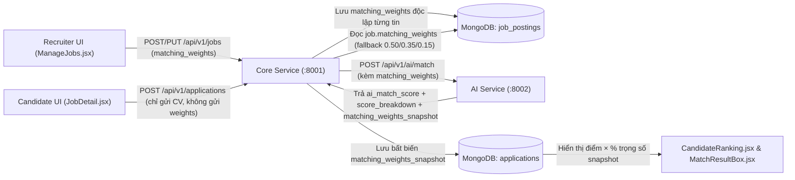

# BÁO CÁO NGHIỆM THU CUỐI CÙNG (PHASE 6)
## Nâng Cấp AI Matching: Trọng Số Cấu Hình Theo Từng Tin Tuyển Dụng (`v2.0-configurable`) & Kiểm Định Thực Nghiệm AI

- **Dự án:** Smart Recruitment Platform (`Recruitment_Project`)
- **Phiên bản AI Matching:** `v2.0-configurable` (nâng cấp từ `v1.0-SBERT`)
- **Mô hình ngôn ngữ nền tảng:** `paraphrase-multilingual-MiniLM-L12-v2` (384 chiều — giữ nguyên 100%)
- **Ngày hoàn thành:** 28/11/2026

---

## 1. Tổng Quan Thay Đổi

Bản nâng cấp chuyển đổi cơ chế tính điểm tổng hợp mức độ phù hợp CV–JD từ công thức cố định toàn hệ thống (`50% Kỹ năng – 35% Ngữ nghĩa – 15% Kinh nghiệm`) sang **cơ chế cấu hình trọng số độc lập theo từng Tin tuyển dụng (`JobPosting`)**, đồng thời bảo toàn tuyệt đối tính bất biến lịch sử chấm điểm (`Application Snapshot`) và tương thích ngược với toàn bộ dữ liệu cũ trong `recruitment_db`.

Các trụ cột đã hoàn thành xuyên suốt hệ thống:
1. **Database & Domain Model:** Lưu `matching_weights` riêng trên từng `job_postings` và `matching_weights_snapshot` bất biến trên từng `applications`.
2. **AI Service (`Port 8002`):** Xác thực nghiêm ngặt trọng số (`MatchingWeights`), tính điểm tổng hợp có trọng số động, gắn nhãn `matching_version = "v2.0-configurable"` và trả về `matching_weights_snapshot` kèm `score_breakdown`.
3. **Core Service (`Port 8001`):** Kiểm soát phân quyền chặt chẽ (`RECRUITER` chủ tin mới được cấu hình trọng số; `CANDIDATE` không thể can thiệp trọng số khi nộp CV hoặc xem trước điểm), tự động đọc trọng số từ `JobPosting` trong MongoDB để truyền sang AI Service.
4. **Frontend (`React + Vite`):** Tích hợp khối **`Cấu hình tiêu chí đánh giá AI`** ngay trong form Tạo/Chỉnh sửa tin tuyển dụng (`ManageJobs.jsx`) với thanh trượt + ô nhập `%` thời gian thực, kiểm tra tổng `100%`, nút **`Khôi phục mặc định`**, và hiển thị minh bạch công thức `điểm × trọng số` trên `CandidateRanking.jsx` và `MatchResultBox.jsx`.
5. **Kiểm thử & Đánh giá thực nghiệm (`scripts/evaluate_ai.py`):** Đạt **52/52** bài test tự động Backend/AI/Gateway, **6/6** luồng E2E trên trình duyệt thật, kiểm định toàn vẹn bộ dữ liệu chuẩn **46 CV PDF + 14 JD TXT** và thực thi **1.932** lượt chấm điểm qua AI Service thật trên **644 cặp CV–JD** với 3 cấu hình trọng số.

---

## 2. Kiến Trúc Trước Và Sau Nâng Cấp

### 2.1. Trước nâng cấp (`v1.0-SBERT`)
- Trọng số `WEIGHT_SKILL = 0.50`, `WEIGHT_SEMANTIC = 0.35`, `WEIGHT_EXPERIENCE = 0.15` bị cố định cứng trong `services/ai-service/app/core/config.py`.
- `JobPosting` không lưu cấu hình trọng số; mọi vị trí tuyển dụng (từ Fresher/Intern đến Senior/Key Account Manager) buộc dùng chung một tỷ lệ.
- `Application` không lưu `matching_weights_snapshot`; các API danh sách ứng viên xếp hạng và chi tiết đơn ứng tuyển chưa trả về tường minh trọng số đã áp dụng tại thời điểm nộp.

### 2.2. Sau nâng cấp (`v2.0-configurable`)



---

## 3. Thiết Kế Cơ Sở Dữ Liệu (Database Schema)

### 3.1. Collection `job_postings`
Mỗi bản ghi `JobPosting` lưu sub-document độc lập `matching_weights`:

```json
{
  "_id": "ObjectId(...)",
  "title": "Senior Backend Developer",
  "matching_weights": {
    "skill_weight": 0.6,
    "semantic_weight": 0.25,
    "experience_weight": 0.15
  }
}
```

- **Mặc định:** `{"skill_weight": 0.5, "semantic_weight": 0.35, "experience_weight": 0.15}`.
- **Tương thích ngược:** 9 bản ghi `job_postings` hiện hữu trong `recruitment_db` chưa có trường `matching_weights` tự động nhận bộ mặc định `0.50 – 0.35 – 0.15` qua `JobService.get_job_matching_weights(job)` và `resolve_matching_weights()` mà không cần chạy script sửa dữ liệu gốc.

### 3.2. Collection `applications`
Mỗi bản ghi `Application` chấm mới lưu thêm `matching_weights_snapshot` (`Optional[MatchingWeights]`):

```json
{
  "_id": "ObjectId(...)",
  "job_id": "ObjectId(...)",
  "candidate_id": "ObjectId(...)",
  "ai_match_score": 94.7,
  "matching_version": "v2.0-configurable",
  "matching_weights_snapshot": {
    "skill_weight": 0.6,
    "semantic_weight": 0.25,
    "experience_weight": 0.15
  },
  "ai_analysis": {
    "matched": ["..."],
    "missing": ["..."],
    "score_breakdown": {
      "skill_score": 100.0,
      "semantic_score": 78.8,
      "experience_score": 100.0,
      "skill_match": 100.0,
      "semantic_match": 78.8,
      "experience_match": 100.0
    },
    "recommendation": "..."
  }
}
```

- **Tính bất biến (Immutability):** Khi Recruiter cập nhật `job_postings.matching_weights`, toàn bộ `Application` đã nộp trước đó **giữ nguyên** `ai_match_score`, `matching_weights_snapshot`, `score_breakdown` và `matching_version`.
- **Tương thích ngược:** 3 bản ghi `applications` cũ (`v1.0-SBERT`) trong `recruitment_db` chưa có `matching_weights_snapshot` trả về `matching_weights_snapshot: null` và giữ nguyên vẹn `score_breakdown` cũ (`skill_match`, `semantic_match`, `experience_match`).

---

## 4. Thay Đổi API & Kiểm Soát Phân Quyền (RBAC)

| Service | Endpoint | Thay đổi chính | Phân quyền & Bảo mật |
|---|---|---|---|
| Core (`:8001`) | `POST /api/v1/jobs`, `POST /api/v1/jobs/managed` | Nhận tùy chọn `matching_weights`; mặc định `0.50/0.35/0.15`; trả `422` nếu tổng $\neq 1.0$, âm, `>1.0` hoặc thiếu trường | Chỉ `RECRUITER` (đã gán công ty). `CANDIDATE` bị chặn `HTTP 403` |
| Core (`:8001`) | `PUT/PATCH /api/v1/jobs/{id}`, `PUT /api/v1/jobs/managed/{id}` | Cập nhật `matching_weights` nếu có gửi; giữ nguyên nếu không gửi; từ chối `null` tường minh (`422`); **không chấm lại đơn cũ** | Chỉ `RECRUITER` sở hữu tin (`job.recruiter_id == user.id`); Recruiter khác bị chặn `HTTP 403` |
| Core (`:8001`) | `GET /api/v1/jobs/managed/{id}`, `GET /api/v1/jobs/my-jobs`, `GET /api/v1/jobs/{id}`, `GET /api/v1/jobs` | Trả kèm `matching_weights` (fallback default cho tin cũ). Thêm `GET /jobs/managed/{id}` cho chủ tin | Chủ tin đối với `/managed/{id}` và `/my-jobs` |
| Core (`:8001`) | `POST /api/v1/applications`, `POST /api/v1/ai-analysis/preview` | Không nhận trọng số từ client; Core tự đọc `job.matching_weights` từ DB truyền sang AI Service; lưu `matching_weights_snapshot` | `CANDIDATE` không thể giả mạo hay ghi đè trọng số |
| Core (`:8001`) | `GET /api/v1/jobs/{id}/applications`, `GET /api/v1/applications/me`, `GET /api/v1/applications/{id}`, `POST /api/v1/ai-analysis/{id}/retry` | Trả đầy đủ `score_breakdown`, `matching_weights_snapshot`, `matching_version` | Đúng vai trò sở hữu tin / chủ hồ sơ |
| AI (`:8002`) | `POST /api/v1/ai/match`, `POST /api/v1/ai/match-cv` | Nhận `matching_weights` (hoặc alias `weights`), kiểm tra hợp lệ `HTTP 422` trước khi chạy model, trả `score_breakdown` + `matching_weights_snapshot` + `matching_version = "v2.0-configurable"` | Nội bộ Core ↔ AI Service |

---

## 5. Công Thức AI Matching (`v2.0-configurable`)

Giữ nguyên 100% mô hình `paraphrase-multilingual-MiniLM-L12-v2`, bộ từ điển `skill_taxonomy.json` (135 kỹ năng chuẩn) và công thức tính 3 điểm thành phần $S_{\text{skill}}, S_{\text{semantic}}, S_{\text{experience}} \in [0, 100]$:

$$\text{ai\_match\_score} = \text{round}\left(w_{\text{skill}} \cdot S_{\text{skill}} + w_{\text{semantic}} \cdot S_{\text{semantic}} + w_{\text{experience}} \cdot S_{\text{experience}},\ 1\right)$$

Ràng buộc xác thực đầu vào trên cả Core Service và AI Service:
- $w_{\text{skill}}, w_{\text{semantic}}, w_{\text{experience}} \in [0.0, 1.0]$, là số thực hữu hạn (loại trừ `bool`, `NaN`, `Infinity`).
- $\left|(w_{\text{skill}} + w_{\text{semantic}} + w_{\text{experience}}) - 1.0\right| \le 10^{-4}$ (xử lý sai số dấu phẩy động IEEE-754 như `0.1 + 0.2 + 0.7`, đồng thời bác bỏ nghiêm ngặt tổng lệch chuẩn hoặc toàn bộ bằng `0`).

---

## 6. Giao Diện Người Dùng Mới (Frontend)

1. **Form Tạo & Chỉnh sửa Tin tuyển dụng (`ManageJobs.jsx`):**
   - Tích hợp khối **`Cấu hình tiêu chí đánh giá AI`** gồm 3 tiêu chí có mô tả rõ ràng: **Kỹ năng chuyên môn (`Skill`)**, **Độ tương đồng ngữ nghĩa (`Semantic`)**, **Mức độ đáp ứng kinh nghiệm (`Experience`)**.
   - Mỗi tiêu chí có đồng bộ 2 chiều giữa thanh kéo (`range slider`) và ô nhập phần trăm (`number input`), kèm thanh phân bổ màu trực quan.
   - Huy hiệu **`Tổng trọng số: X% / 100%`** cảnh báo đỏ tức thì và khóa nút Lưu nếu tổng khác `100%` hoặc có giá trị âm.
   - Nút **`Khôi phục mặc định`** đưa ngay về `50% – 35% – 15%`.
   - Danh sách tin tuyển dụng hiển thị huy hiệu `AI: X% · Y% · Z%` cho từng tin.
2. **Xếp hạng Ứng viên (`CandidateRanking.jsx`) & Hộp Kết quả AI (`MatchResultBox.jsx`):**
   - Hiển thị rõ trọng số hiện hành của tin tuyển dụng trên thanh tiêu đề.
   - Trên từng ứng viên và panel chi tiết: hiển thị **`Điểm phù hợp: X/100`**, **`Trọng số đã sử dụng: Kỹ năng X% – Ngữ nghĩa Y% – Kinh nghiệm Z%`** (lấy từ `matching_weights_snapshot`), và công thức từng thẻ **`S điểm × W% (+đóng góp điểm)`**.
   - Với hồ sơ cũ `v1.0-SBERT` chưa có snapshot (`matching_weights_snapshot = null`), hiển thị `Phiên bản v1.0-SBERT` kèm nhãn tương thích ngược lịch sử `'Trọng số mặc định: Kỹ năng 50% · Ngữ nghĩa 35% · Kinh nghiệm 15% (bản ghi trước v2.0)'` mà không gây lỗi giao diện.

---

## 7. Danh Sách Đầy Đủ File Đã Sửa / Tạo Mới

### 7.1. File mã nguồn đã chỉnh sửa (18 files)
1. [config.py](file:///f:/MonHoc/Do_an_chuyen_nganh/Recruitment_project%20-%20Copy/services/ai-service/app/core/config.py) — Cập nhật `MATCHING_VERSION = "v2.0-configurable"`, giữ nguyên hằng số mặc định `0.50 / 0.35 / 0.15`.
2. [matching.py](file:///f:/MonHoc/Do_an_chuyen_nganh/Recruitment_project%20-%20Copy/services/ai-service/app/schemas/matching.py) — Định nghĩa `MatchingWeights` kèm bộ kiểm tra biên nghiêm ngặt, mở rộng `MatchingRequest` và `MatchingResponse`.
3. [similarity.py](file:///f:/MonHoc/Do_an_chuyen_nganh/Recruitment_project%20-%20Copy/services/ai-service/app/services/similarity.py) — Bổ sung `resolve_weights()`, `compute_weighted_score()` và cập nhật `evaluate_cv_jd()` tính điểm theo trọng số cấu hình.
4. [ai_matching.py](file:///f:/MonHoc/Do_an_chuyen_nganh/Recruitment_project%20-%20Copy/services/ai-service/app/routers/ai_matching.py) — Hỗ trợ truyền `matching_weights` qua cả JSON (`/match`) và Multipart Form (`/match-cv`), chuẩn hóa lỗi `HTTP 422`.
5. [job.py (Model)](file:///f:/MonHoc/Do_an_chuyen_nganh/Recruitment_project%20-%20Copy/services/core-service/app/models/job.py) — Thêm sub-document `MatchingWeights` vào `JobPosting`.
6. [job.py (Schema)](file:///f:/MonHoc/Do_an_chuyen_nganh/Recruitment_project%20-%20Copy/services/core-service/app/schemas/job.py) — Thêm `MatchingWeightsSchema`, `resolve_matching_weights()`, mở rộng `JobCreateSchema` và `JobUpdateSchema`.
7. [job_service.py](file:///f:/MonHoc/Do_an_chuyen_nganh/Recruitment_project%20-%20Copy/services/core-service/app/services/job_service.py) — Lưu `matching_weights` khi tạo/sửa tin, thêm `get_job_matching_weights()` và `get_managed_job()`.
8. [jobs.py](file:///f:/MonHoc/Do_an_chuyen_nganh/Recruitment_project%20-%20Copy/services/core-service/app/routers/jobs.py) — Trả `matching_weights` trong mọi API tin tuyển dụng và bổ sung `GET /api/v1/jobs/managed/{job_id}`.
9. [application.py (Model)](file:///f:/MonHoc/Do_an_chuyen_nganh/Recruitment_project%20-%20Copy/services/core-service/app/models/application.py) — Thêm `matching_weights_snapshot: Optional[MatchingWeights] = None` vào `Application`.
10. [application.py (Schema)](file:///f:/MonHoc/Do_an_chuyen_nganh/Recruitment_project%20-%20Copy/services/core-service/app/schemas/application.py) — Bổ sung `score_breakdown`, `matching_weights_snapshot`, `matching_version` vào schema phản hồi đơn ứng tuyển và bảng xếp hạng.
11. [application_service.py](file:///f:/MonHoc/Do_an_chuyen_nganh/Recruitment_project%20-%20Copy/services/core-service/app/services/application_service.py) — Đọc trọng số từ `JobPosting` gửi sang AI Service, lưu `matching_weights_snapshot` bất biến khi nộp đơn, và trả về đầy đủ dữ liệu phân tích.
12. [ai_analysis.py](file:///f:/MonHoc/Do_an_chuyen_nganh/Recruitment_project%20-%20Copy/services/core-service/app/routers/ai_analysis.py) — Cập nhật `/preview` và `/retry` sử dụng đúng trọng số của `JobPosting` và lưu/trả về `matching_weights_snapshot`.
13. [ManageJobs.jsx](file:///f:/MonHoc/Do_an_chuyen_nganh/Recruitment_project%20-%20Copy/frontend/src/pages/recruiter/ManageJobs.jsx) — Xây dựng giao diện cấu hình trọng số AI khi tạo/chỉnh sửa tin tuyển dụng và hiển thị badge trọng số trên bảng quản lý tin.
14. [CandidateRanking.jsx](file:///f:/MonHoc/Do_an_chuyen_nganh/Recruitment_project%20-%20Copy/frontend/src/pages/recruiter/CandidateRanking.jsx) — Hiển thị điểm tổng, trọng số snapshot đã áp dụng, công thức `điểm × %` và thông báo tương thích ngược cho đơn cũ.
15. [MatchResultBox.jsx](file:///f:/MonHoc/Do_an_chuyen_nganh/Recruitment_project%20-%20Copy/frontend/src/components/MatchResultBox.jsx) — Hiển thị chi tiết trọng số và đóng góp từng thành phần ở màn xem trước điểm và chi tiết đơn ứng tuyển.
16. [jobService.js](file:///f:/MonHoc/Do_an_chuyen_nganh/Recruitment_project%20-%20Copy/frontend/src/services/jobService.js) — Bổ sung `getManagedJob(id)` phục vụ `CandidateRanking.jsx` tải tiêu đề và cấu hình `matching_weights` hiện hành của tin tuyển dụng thuộc quyền sở hữu (kể cả khi tin ở trạng thái `CLOSED`/`HIDDEN`), kèm fallback sang `getMyJobs()`.
17. [aiMatchingService.js](file:///f:/MonHoc/Do_an_chuyen_nganh/Recruitment_project%20-%20Copy/frontend/src/services/aiMatchingService.js) — Hỗ trợ truyền tùy chọn `matching_weights` cho tiện ích gọi trực tiếp `/match-cv`.
18. [index.css](file:///f:/MonHoc/Do_an_chuyen_nganh/Recruitment_project%20-%20Copy/frontend/src/index.css) — Bổ sung style đồng bộ Design System cho khối cấu hình trọng số, thanh phân bổ tỷ lệ và tooltip điểm chi tiết.

### 7.2. File kiểm thử, script thực nghiệm & tài liệu tạo mới (10 files)
1. [test_configurable_weights.py (AI Service)](file:///f:/MonHoc/Do_an_chuyen_nganh/Recruitment_project%20-%20Copy/services/ai-service/tests/test_configurable_weights.py) — 12 bài Unit/API test cho công thức trọng số động và các trường hợp biên trên AI Service.
2. [test_configurable_weights.py (Core Service)](file:///f:/MonHoc/Do_an_chuyen_nganh/Recruitment_project%20-%20Copy/services/core-service/tests/test_configurable_weights.py) — 1 kịch bản tích hợp toàn diện kiểm chứng RBAC, tính độc lập giữa các Job, tính bất biến của Snapshot và tương thích ngược trên raw MongoDB documents.
3. [evaluate_ai.py](file:///f:/MonHoc/Do_an_chuyen_nganh/Recruitment_project%20-%20Copy/scripts/evaluate_ai.py) — Pipeline kiểm định Dataset `CV_JD`, đánh giá Precision/Recall/F1 cho trích xuất kỹ năng và so sánh 3 cấu hình trọng số trên 644 cặp CV–JD qua AI Service thực tế (hỗ trợ checkpoint chạy lại).
4. [evaluation_summary.json](file:///f:/MonHoc/Do_an_chuyen_nganh/Recruitment_project%20-%20Copy/docs/ai_matching/evaluation_results/evaluation_summary.json) — Tổng hợp kết quả kiểm định dữ liệu, chỉ số trích xuất kỹ năng và thống kê dịch chuyển điểm/thứ hạng 3 cấu hình.
5. [skill_extraction_metrics.csv](file:///f:/MonHoc/Do_an_chuyen_nganh/Recruitment_project%20-%20Copy/docs/ai_matching/evaluation_results/skill_extraction_metrics.csv) — Kết quả TP, FP, FN, Precision, Recall, F1 chi tiết trên từng CV trong 46 CV PDF.
6. [weight_configs_644_pairs.csv](file:///f:/MonHoc/Do_an_chuyen_nganh/Recruitment_project%20-%20Copy/docs/ai_matching/evaluation_results/weight_configs_644_pairs.csv) — Bảng điểm thành phần, điểm tổng và thứ hạng của toàn bộ 644 cặp CV–JD dưới 3 cấu hình trọng số.
7. [per_jd_ranking_comparison.csv](file:///f:/MonHoc/Do_an_chuyen_nganh/Recruitment_project%20-%20Copy/docs/ai_matching/evaluation_results/per_jd_ranking_comparison.csv) — So sánh Top-1, độ trùng lặp Top-5 và hệ số tương quan hạng Spearman theo từng bản JD trong 14 JD.
8. [checkpoint_parse_and_match.json](file:///f:/MonHoc/Do_an_chuyen_nganh/Recruitment_project%20-%20Copy/docs/ai_matching/evaluation_results/checkpoint_parse_and_match.json) — Dữ liệu lưu vết thực thi thực tế từ AI Service giúp tái lập kết quả tức thì.
9. [configurable_weights_audit.md](file:///f:/MonHoc/Do_an_chuyen_nganh/Recruitment_project%20-%20Copy/docs/ai_matching/configurable_weights_audit.md) & [configurable_weights_design.md](file:///f:/MonHoc/Do_an_chuyen_nganh/Recruitment_project%20-%20Copy/docs/ai_matching/configurable_weights_design.md) — Báo cáo Audit Phase 0 và Thiết kế Kiến trúc Phase 1.
10. [configurable_weights_final_report.md](file:///f:/MonHoc/Do_an_chuyen_nganh/Recruitment_project%20-%20Copy/docs/ai_matching/configurable_weights_final_report.md) — Báo cáo nghiệm thu tổng kết Phase 6 (tài liệu hiện tại).

---

## 8. Kết Quả Kiểm Thử Tự Động & E2E Thực Tế

### 8.1. Tổng hợp Automated Tests & Build

| Nhóm kiểm thử | Lệnh thực thi | Kết quả | Thời gian |
|---|---|---|---|
| **AI Service Unit & API Tests** | `python -m pytest services/ai-service/tests -o pythonpath=services/ai-service -v` | **17/17 PASSED** (12 test mới + 5 test cũ) | `24.16s` |
| **Core Service Integration & Regression Tests** | `python -m pytest services/core-service/tests -o pythonpath=services/core-service -v` | **31/31 PASSED** (1 kịch bản E2E mới + 30 test cũ) | `14.62s` |
| **API Gateway Tests** | `python -m pytest services/api-gateway/tests -o pythonpath=services/api-gateway -v` | **4/4 PASSED** | `0.52s` |
| **Frontend ESLint** | `npm run lint` (tại `frontend/`) | **PASS** (`0 errors, 0 warnings`) | `~2.1s` |
| **Frontend Production Build** | `npm run build` (tại `frontend/`) | **PASS** (`132 modules transformed`) | `606ms` |

**Chi tiết các trường hợp kiểm thử trọng tâm đã PASS:**
- **Test Case 1 — Custom weights `(0.60, 0.25, 0.15)`:** Với `(90, 80, 80)` → trả chính xác `86.0` (`54 + 20 + 12`).
- **Test Case 2 — Default weights `(0.50, 0.35, 0.15)`:** Không truyền `matching_weights` → fallback chính xác `(0.50, 0.35, 0.15)`, với `(90, 80, 80)` cho `85.0` và với `(89, 80, 80)` cho `84.5`.
- **Test Case 3 — Invalid weights:** Tổng `= 0.90`, tổng `= 1.20`, số âm `-0.10`, giá trị `> 1.0`, tất cả bằng `0`, thiếu trường, thừa trường lạ, hoặc `null` khi update → đồng loạt bị từ chối với **`HTTP 422 Unprocessable Entity`**.
- **Test Case 4 — Extreme weights `(1.00, 0.00, 0.00)`:** Với `(90, 80, 80)` → trả chính xác `90.0`.
- **RBAC & Bảo mật:** Candidate gọi tạo/sửa Job bị chặn `HTTP 403`; Recruiter B sửa Job của Recruiter A bị chặn `HTTP 403`; Candidate truyền lén `matching_weights` khi nộp đơn không làm thay đổi trọng số thực tế của Job.
- **Backward Compatibility:** Bản ghi `job_postings` thô không có `matching_weights` và `applications` thô `v1.0-SBERT` không có `matching_weights_snapshot` (chỉ có `skill_match`/`semantic_match`/`experience_match`) đều serialize và hiển thị chuẩn xác.

### 8.2. Kiểm thử Real Browser E2E (`http://127.0.0.1:5173`)
Thực thi trên 4 tiến trình thật (`Gateway :8000`, `Core :8001` trên DB test cô lập `recruitment_e2e_weights`, `AI Service :8002`, `Vite :5173` với `VITE_MOCK_AUTH=false`):
1. **Flow 1 (Validation UI):** Recruiter mở modal đăng tin, chỉnh Kỹ năng `70%` làm tổng nhảy `120% / 100%` → cảnh báo đỏ xuất hiện, nút submit bị khóa; bấm **`Khôi phục mặc định`** → quay chuẩn về `50% – 35% – 15%`.
2. **Flow 2 (Tạo 2 tin độc lập):** Tạo **Job A** (`60% – 25% – 15%`) và **Job B** (`40% – 20% – 40%`) → danh sách tin hiển thị đúng 2 huy hiệu độc lập `AI: 60% · 25% · 15%` và `AI: 40% · 20% · 40%`.
3. **Flow 3 (Candidate ứng tuyển PDF thật):** Candidate `Nguyen Van Minh` tải CV PDF lên và nộp vào Job A.
4. **Flow 4 (Kiểm chứng điểm & công thức):** AI chấm `S_skill = 100`, `S_semantic = 78.8`, `S_experience = 100` với trọng số Job A `(0.60, 0.25, 0.15)`:
   $$100 \times 0.60 + 78.8 \times 0.25 + 100 \times 0.15 = 60.0 + 19.7 + 15.0 = 94.7$$
   Giao diện `CandidateRanking.jsx` hiển thị chính xác **`Điểm phù hợp: 94.7/100`**, **`Trọng số đã sử dụng: Kỹ năng 60% – Ngữ nghĩa 25% – Kinh nghiệm 15%`**, và từng thẻ `100 điểm × 60% (+60.0)`, `78.8 điểm × 25% (+19.7)`, `100 điểm × 15% (+15.0)`.
5. **Flow 5 & 6 (Tính bất biến Snapshot sau khi sửa trọng số Job):** Recruiter sửa trọng số **Job A** sang `30% – 30% – 40%`. Quay lại bảng xếp hạng Job A: thanh tiêu đề cập nhật trọng số mới của tin là `30% – 30% – 40%`, nhưng hồ sơ đã nộp của `Nguyen Van Minh` **giữ nguyên bất biến `94.7/100`** cùng huy hiệu snapshot **`TS: 60%·25%·15%`**.
- **Lỗi Console / Network:** `0` lỗi Console, `0` lỗi HTTP `4xx/5xx`.
- **Ảnh chụp màn hình bằng chứng:** `C:/Users/ADMIN/.gemini/antigravity/brain/2f07e76f-6674-4bc1-b266-c760e75c033a/browser_evidence/abf3f270-bf71-43d8-be97-6aa120a0a77c/final_step_53.png`.
- **Bảo toàn dữ liệu thật:** Đã xóa DB test `recruitment_e2e_weights`; kiểm tra `recruitment_db` giữ nguyên tuyệt đối (`job_postings: 9`, `applications: 3`, `users: 13`, `companies: 5`, `skills_taxonomy: 147`).

---

## 9. Kết Quả Kiểm Định Dataset & Thực Nghiệm Mô Hình AI (Phase 5)

### 9.1. Kiểm định mức độ sẵn sàng của Dataset (`CV/CV_JD-20261127T160544Z-1-001.zip`)

| Hạng mục kiểm tra | Kết quả thực tế | Đánh giá |
|---|---|---|
| Số lượng CV PDF (`CV_JD/cv/`) | **46/46** file PDF đọc thành công bằng PyMuPDF (`0` file lỗi/rỗng, `0` file trùng SHA-256) | **READY** |
| Số lượng JD TXT (`CV_JD/jd/`) | **14/14** file TXT tiếng Việt đọc thành công, khớp 100% với `jd_metadata.csv` | **READY** |
| Đối chiếu `skill_taxonomy.json` | 135 kỹ năng chuẩn khớp 100% với AI Service; `0` kỹ năng ngoài từ điển trong cả `cv_metadata.csv` và `jd_metadata.csv` | **READY** |
| Nhãn `skills_ground_truth` trong `cv_metadata.csv` | Có sẵn cho 46 CV (44 CV có kỹ năng `>0`; 2 CV Kế toán `cv_035_KeToan.pdf`, `cv_036_KeToan.pdf` có cột kỹ năng rỗng hợp lệ theo `README.md`) | **READY** |
| Nhãn điểm phù hợp cặp CV–JD (`Human Score`) | **Chưa có** trong gói dữ liệu (`0` dòng) → Chỉ số **MAE** | **BLOCKED** |
| Nhãn mức độ phù hợp cặp CV–JD (`Human Relevance`) | **Chưa có** trong gói dữ liệu (`0` dòng) → Chỉ số **Precision@5** | **BLOCKED** |
| Nhãn ứng viên chuẩn để đo độ chính xác xếp hạng Top-K | **Chưa có** `Human Ground Truth` cấp cặp CV–JD → Chỉ số **Top-K Accuracy** | **BLOCKED** |

### 9.2. Đánh giá Trích xuất Kỹ năng (Skill Extraction) trên 46 CV PDF thật
Thực thi qua endpoint thật `POST http://127.0.0.1:8002/api/v1/ai/parse-cv` cho toàn bộ 46 CV PDF:

| Phương thức tổng hợp | Tổng TP | Tổng FP | Tổng FN | Precision | Recall | F1-Score |
|---|---:|---:|---:|---:|---:|---:|
| **Micro-average (toàn bộ 46 CV)** | **351** | **17** | **2** | **95.38%** (`0.9538`) | **99.43%** (`0.9943`) | **97.36%** (`0.9736`) |
| **Macro-average (44 CV có GT $\neq \emptyset$)** | — | — | — | **95.63%** (`0.9563`) | **99.55%** (`0.9955`) | **97.11%** (`0.9711`) |
| **Macro-average (toàn bộ 46 CV, gồm 2 CV GT rỗng)** | — | — | — | **91.47%** (`0.9147`) | **95.23%** (`0.9523`) | **92.89%** (`0.9289`) |

**Phân tích kỹ thuật từ số liệu thực nghiệm (`skill_extraction_metrics.csv`):**
- **33 / 46 CV (71.74%)** đạt điểm tuyệt đối **`F1 = 1.0000`** trên cả 3 kiểu bố cục (`classic`, `sidebar`, `minimal`) và 6 nhóm ngành (`IT`, `Marketing`, `Sales`, `Kế toán`, `Nhân sự`, `Thiết kế`).
- **Chỉ phát sinh 2 False Negatives trên tổng số 353 nhãn kỹ năng thật (`Recall = 99.43%`):** `Automation Testing` ở `cv_008_IT.pdf` và `Email Marketing` ở `cv_020_Marketing.pdf` (cả hai đều có bố cục `sidebar` nhiều cột khiến cụm từ ghép xuống dòng khi trích xuất văn bản PDF).
- **Nguyên nhân của 17 False Positives:** Theo ghi chú chính thức trong `CV_JD/README.md`, cột `skills_ground_truth` chỉ được gán nhãn từ mục **"Kỹ năng"** của CV, trong khi `CVParserService` quét toàn văn bản CV bao gồm cả phần **"Kinh nghiệm làm việc"** và **"Dự án"** (ví dụ `cv_001_IT.pdf` trích thêm `JUnit, Oracle, Scrum` có xuất hiện thật trong mô tả dự án; `cv_035_KeToan.pdf` và `cv_036_KeToan.pdf` có `skills_ground_truth` rỗng nhưng nội dung công việc Kế toán nhắc tới `Excel`). Như vậy các FP này phản ánh sự khác biệt phạm vi gán nhãn chứ không phải lỗi nhận diện sai từ khóa.

### 9.3. So sánh 3 Cấu hình Trọng số trên 644 cặp CV–JD (`46 CV × 14 JD = 1.932` lượt gọi AI Service)
Thực thi trực tiếp qua `POST http://127.0.0.1:8002/api/v1/ai/match` trong `138.39 giây`:

| Cấu hình trọng số | Tỷ lệ (`Skill – Semantic – Exp`) | Điểm TB (`Mean ± SD`) | Khoảng điểm (`Min – Max`) | Số cặp `>= 80` | Số cặp `60 – <80` | Số cặp `< 60` | Trùng Top-5 TB so với Baseline | Tương quan hạng Spearman TB |
|---|---|---:|---:|---:|---:|---:|---:|---:|
| **Baseline** | `50% – 35% – 15%` | `36.38 ± 16.24` | `4.7 – 94.7` | 26 | 31 | 587 | `5.00 / 5` | `1.0000` |
| **Configuration A** (Ưu tiên Kỹ năng) | `60% – 25% – 15%` | `33.75 ± 18.03` | `3.4 – 96.2` | 33 | 24 | 587 | `4.93 / 5` | `0.9917` |
| **Configuration B** (Cân bằng Kỹ năng & Kinh nghiệm) | `40% – 20% – 40%` | `50.48 ± 15.45` | `2.7 – 97.0` | 37 | 74 | 533 | `4.71 / 5` | `0.9388` |

**Các minh chứng dịch chuyển điểm & thứ hạng tiêu biểu (từ `weight_configs_644_pairs.csv`):**
1. **Tác động lọc ứng viên thiếu kinh nghiệm khi dùng Configuration B (`40% – 20% – 40%`):**
   - Với `jd_09_Digital_Marketing_Performance.txt` (yêu cầu *Từ 2 năm*), ứng viên Thực tập sinh `cv_026_Marketing.pdf` (`S=60.0, Sem=73.0, Exp=0.0`) đứng **Hạng #4 (`55.5 điểm`)** ở Baseline nhờ điểm ngữ nghĩa cao, nhưng khi Recruiter cấu hình **Configuration B** ưu tiên kinh nghiệm (`40%`), điểm giảm xuống **`38.6` và tụt 40 bậc xuống Hạng #44**, nhường vị trí Top 5 cho `cv_023_Marketing.pdf` (`Exp=100.0`, tăng từ **Hạng #6 lên #5**, điểm `53.3 → 66.4`).
   - Tương tự ở `jd_04_Data_Engineer.txt` (*Từ 3 năm*), ứng viên Junior `cv_018_IT.pdf` (`Exp=66.7`) từ **Hạng #3 (`51.0`)** ở Baseline lùi xuống **Hạng #12 (`55.0`)** ở Configuration B.
2. **Tác động phân hóa kỹ năng chuyên môn khi dùng Configuration A (`60% – 25% – 15%`):**
   - Độ lệch chuẩn điểm tăng từ `16.24` lên **`18.03`** và số cặp đạt ngưỡng xuất sắc (`>= 80 điểm`) tăng từ **26 lên 33 cặp**, giúp tách bạch rõ nhóm ứng viên đúng chuyên môn kỹ thuật.
   - Ở `jd_01_Backend_Developer_Java.txt`, `cv_012_IT.pdf` (`S=50.0, Sem=34.6, Exp=100.0`) vượt qua `cv_017_IT.pdf` (`S=37.5, Sem=53.1, Exp=100.0`) để vươn từ **Hạng #5 (`52.1`) lên Hạng #4 (`53.6`)** khi tăng trọng số kỹ năng lên `60%`.
   - Ở `jd_12_Key_Account_Manager.txt`, `cv_034_Sales.pdf` (`S=100.0, Sem=38.1, Exp=100.0`) vượt qua `cv_023_Marketing.pdf` (`S=100.0, Sem=47.2, Exp=80.0`) để lên **Hạng #2** ở cả Configuration A (`84.5` vs `83.8`) và Configuration B (`87.6` vs `81.4`).
3. **Tính ổn định ở nhóm dẫn đầu tuyệt đối:** Trên cả 14/14 bản JD, ứng viên **Top-1** hoàn toàn không đổi giữa 3 cấu hình vì ứng viên phù hợp nhất cho mỗi JD đều đồng thời đạt điểm cao ở cả 3 trụ cột Kỹ năng, Ngữ nghĩa và Kinh nghiệm.

---

## 10. Các Vấn Đề Còn Tồn Tại & Giới Hạn Dữ Liệu

1. **`MAE`, `Precision@5` và `Top-K Accuracy` đang ở trạng thái `BLOCKED` (Giới hạn dữ liệu Ground Truth):**
   - Gói dữ liệu chuẩn `CV/CV_JD-20261127T160544Z-1-001.zip` hiện chỉ có nhãn kỹ năng chuẩn của từng CV (`skills_ground_truth`), chưa có bảng chấm điểm thủ công của chuyên gia nhân sự (`human_score`) hay nhãn mức độ liên quan/ứng viên chuẩn (`relevant`) cho các cặp CV–JD.
   - Tuân thủ nghiêm ngặt quy định không tự tạo nhãn giả, các chỉ số đánh giá có giám sát cấp cặp CV–JD gồm **`MAE: BLOCKED`**, **`Precision@5: BLOCKED`** và **`Top-K Accuracy: BLOCKED`** được giữ nguyên trạng thái `BLOCKED` trung thực (chỉ số `Trùng Top-5 TB` ở Mục 9.3 chỉ đo độ ổn định thứ hạng giữa các cấu hình trọng số với nhau, không phải `Top-K Accuracy` đối chiếu Ground Truth). Pipeline `scripts/evaluate_ai.py` đã hỗ trợ sẵn tham số `--pair-gt <file.csv>` để tính toán ngay khi nhóm bổ sung dữ liệu chấm tay.
2. **Lưu ý cấu hình môi trường Frontend khi bảo vệ đồ án (`frontend/.env`):**
   - File `frontend/.env` hiện có trên máy đang để `VITE_MOCK_AUTH=true` (phục vụ phát triển giao diện độc lập trước đây). Theo quy tắc không tự ý sửa các cấu hình ngoài phạm vi, file này được giữ nguyên trên ổ đĩa; khi chạy demo/bảo vệ kết nối Backend thật, cần đặt `VITE_MOCK_AUTH=false` (hoặc truyền biến môi trường `$env:VITE_MOCK_AUTH="false"` trước lệnh `npm run dev`).
3. **Chuẩn hóa nối dòng PDF nhiều cột (`sidebar`):**
   - Hai trường hợp bỏ sót kỹ năng duy nhất (`Automation Testing`, `Email Marketing`) xuất phát từ việc từ ghép bị ngắt dòng trong cột hẹp của layout `sidebar`. Có thể cải thiện thêm ở phiên bản tiếp theo bằng bước chuẩn hóa nối dòng mềm trước khi khớp regex từ điển.

---

## 11. Hướng Dẫn Chạy Thử Hệ Thống & Tái Lập Thực Nghiệm

### 11.1. Khởi chạy hệ thống đầy đủ trên máy bảo vệ (Windows PowerShell — không cần Docker)
Đảm bảo MongoDB đang chạy tại `127.0.0.1:27017`, sau đó mở 4 cửa sổ PowerShell tại thư mục gốc dự án:

```powershell
# Terminal 1 — AI Service (Port 8002)
cd services\ai-service
python -m uvicorn app.main:app --host 127.0.0.1 --port 8002

# Terminal 2 — Core Service (Port 8001)
cd services\core-service
python -m uvicorn app.main:app --host 127.0.0.1 --port 8001

# Terminal 3 — API Gateway (Port 8000)
cd services\api-gateway
python -m uvicorn app.main:app --host 127.0.0.1 --port 8000

# Terminal 4 — Frontend (Port 5173, kết nối API thật)
cd frontend
$env:VITE_MOCK_AUTH="false"
npm run dev -- --host 127.0.0.1 --port 5173
```

### 11.2. Chạy lại toàn bộ Automated Tests & Pipeline đánh giá AI

```powershell
# Chạy kiểm thử AI Service (17 tests), Core Service (31 tests), API Gateway (4 tests)
python -m pytest services/ai-service/tests -o pythonpath=services/ai-service -v
python -m pytest services/core-service/tests -o pythonpath=services/core-service -v
python -m pytest services/api-gateway/tests -o pythonpath=services/api-gateway -v

# Chạy lại thực nghiệm AI trên 46 CV & 14 JD (yêu cầu AI Service đang chạy ở cổng 8002)
python scripts\evaluate_ai.py
```

---

## 12. Đối Chiếu Tiêu Chí Nghiệm Thu (Acceptance Criteria) & Kết Luận

| STT | Tiêu chí nghiệm thu (Acceptance Criteria) | Trạng thái | Bằng chứng xác thực |
|---:|---|---|---|
| 1 | Recruiter cấu hình được trọng số riêng khi tạo từng Job Posting | **PASS** | `ManageJobs.jsx`, `POST /api/v1/jobs`, Browser E2E Flow 2 |
| 2 | Recruiter chỉnh sửa được trọng số của Job Posting thuộc quyền sở hữu | **PASS** | `PUT /api/v1/jobs/managed/{id}`, Browser E2E Flow 5 |
| 3 | Hai Job Posting khác nhau lưu và áp dụng hai bộ trọng số độc lập | **PASS** | Job A (`60/25/15`) vs Job B (`40/20/40`) trong Core Integration Test & Browser E2E |
| 4 | Không nhập trọng số thì mặc định chính xác `50% – 35% – 15%` | **PASS** | `test_default_weights_fallback`, nút `Khôi phục mặc định` |
| 5 | Tổng trọng số $\neq 100\%$ hoặc âm / `>100%` bị từ chối ở cả UI và Backend | **PASS** | Khóa nút Lưu trên UI + `HTTP 422` tại Core Service & AI Service |
| 6 | Candidate ứng tuyển được chấm điểm bằng đúng trọng số của Job Posting và không thể tự gửi trọng số | **PASS** | `_call_ai_match()` đọc từ DB; E2E chấm chính xác `94.7/100` |
| 7 | `Application` lưu `matching_weights_snapshot` và **không bị tính lại điểm** khi Job đổi trọng số | **PASS** | `Nguyen Van Minh` giữ nguyên `94.7/100` (`TS: 60%·25%·15%`) sau khi Job A đổi sang `30%·30%·40%` |
| 8 | Các Job Posting cũ (9 tin) và Application cũ (3 đơn) hoạt động bình thường, không mất dữ liệu | **PASS** | Raw MongoDB legacy test + bảo toàn nguyên trạng `recruitment_db` |
| 9 | Giao diện hiển thị minh bạch điểm tổng, trọng số đã dùng và đóng góp từng tiêu chí | **PASS** | `CandidateRanking.jsx`, `MatchResultBox.jsx`, ảnh chụp màn hình `final_step_53.png` |
| 10 | Toàn bộ Unit Test, Integration Test, Lint/Build và Real Browser E2E đều PASS | **PASS** | `52/52` pytest PASS, `eslint` + `vite build` PASS, `6/6` Browser E2E flows PASS |
| 11 | Báo cáo trung thực mức độ sẵn sàng của Dataset và kết quả thực nghiệm mô hình | **PASS (MAE, Precision@5 & Top-K Accuracy: BLOCKED)** | `evaluation_summary.json` (Skill F1 Micro `97.36%`, `33/46` CV đạt `F1=1.0`, 644 cặp × 3 cấu hình hoàn tất; `MAE`, `Precision@5` & `Top-K Accuracy` đánh dấu `BLOCKED` do thiếu `Human Ground Truth` cặp CV–JD) |

### KẾT LUẬN CHUNG
- **Tính năng Configurable AI Matching Weights (`Phase 1 → Phase 4` & `Phase 6`):** **PASS TOÀN DIỆN (100%)** — sẵn sàng đưa vào sử dụng và bảo vệ đồ án mà không gây bất kỳ rủi ro hồi quy hay sai lệch dữ liệu nào.
- **Kiểm định Dataset & Đánh giá AI (`Phase 5`):** **PARTIAL PASS (Đúng giới hạn dữ liệu đã phê duyệt)** — Hoàn tất 100% kiểm định dữ liệu, đánh giá Skill Extraction (`Micro F1 = 97.36%`, `33/46` CV đạt `F1 = 1.0000`) và thực nghiệm so sánh 3 cấu hình trọng số trên 644 cặp CV–JD; riêng 3 chỉ số `MAE`, `Precision@5` và `Top-K Accuracy` được giữ trạng thái **`BLOCKED`** trung thực cho tới khi bổ sung nhãn chấm tay của con người (`Human Ground Truth`) cho các cặp CV–JD.
